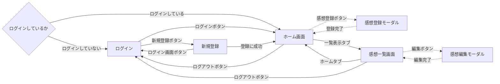
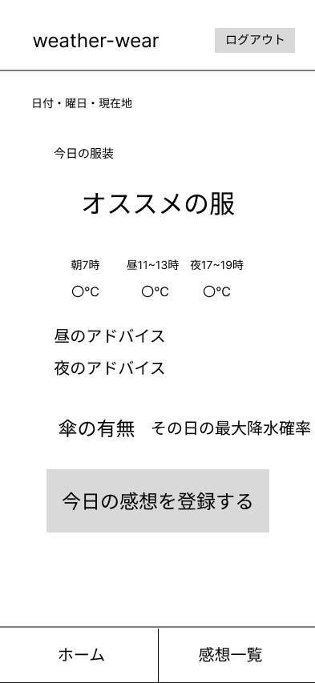
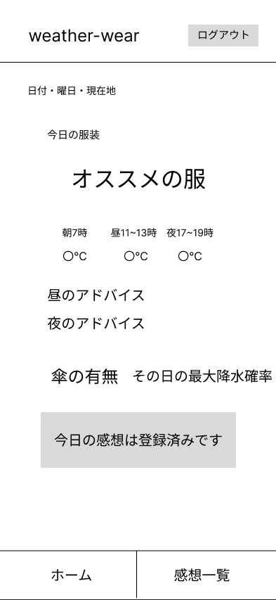
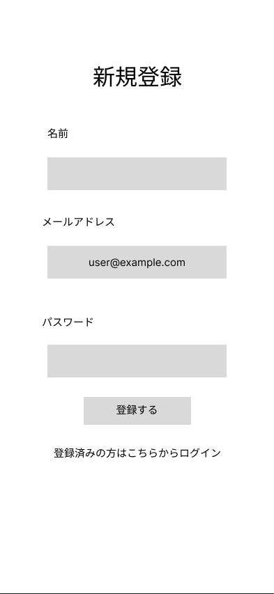
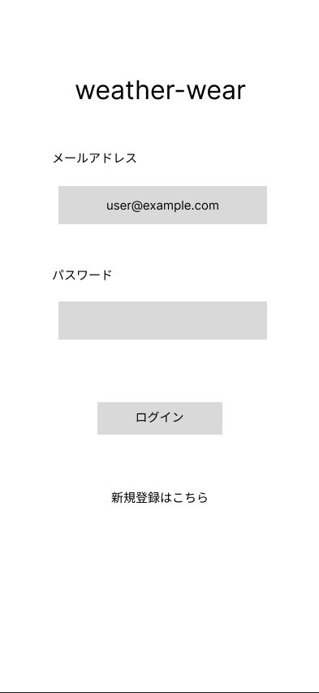
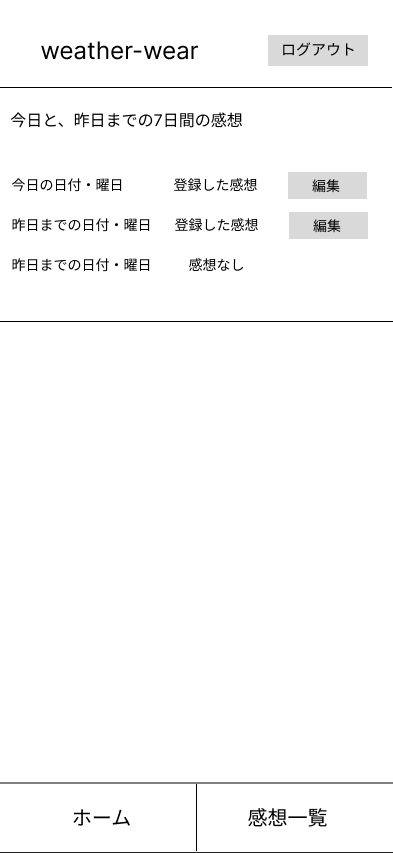
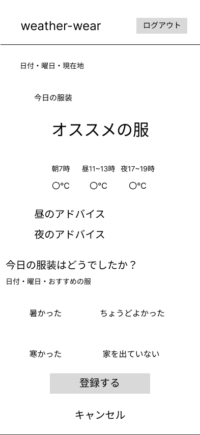

# 画面

<!-- 自分で書く。チェックポイント③の合格条件:
     ②のすべての機能に対応する画面がある / 画面遷移図がある /
     読み込み中・0件・エラーのときの表示が決まっている -->

## 画面遷移図

## 各画面

### ホーム画面

- 正常:
  - タイトル
  - ログアウトボタン
  - 今日のおすすめの服装
  - 時間帯ごとの体感温度
  - 昼と夜の上着などのアドバイス
  - 傘(降水確率が40%以上で表示、超えていない場合はその日の最大降水確率と時間のみ)
  - 感想登録ボタン(登録済みならグレーアウトして「今日の感想は登録済みです」)
  - ホームタブ
  - 感想一覧タブ
- 読み込み中:
  - 「天気を取得しています...」などの文
- 0件:なし
- エラー:
  - 位置情報が許可されていない→「ブラウザの設定で位置情報を許可してから、もう一度読み込んでください」などの文ともう一度読み込むボタン
  - 天気APIが失敗→「情報の取得に失敗しました」などの文ともう一度読み込むボタン
  - ログインの有効期限切れ→ログイン画面に遷移

### 新規登録画面

- 正常:
  - 名前入力欄
  - メールアドレス入力欄
  - パスワード入力欄
  - 新規登録ボタン
- 読み込み中:
  - スピナー(ボタンを押せないようにする)
- 0件:なし
- エラー:
  - 「メールアドレスが既に使用されている」などの文
  - 「名前を入力してください」などの文
  - 「メールアドレスの形式が正しくない」などの文
  - 「パスワードは8文字以上にしてください」などの文

### ログイン画面

- 正常:
  - メールアドレス入力欄
  - パスワード入力欄
  - ログインボタン
- 読み込み中:
  - スピナー(ボタンを押せないようにする)
- 0件:なし
- エラー:
  - 「メールアドレス、またはパスワードが違う」などの文
  - 「メールアドレスの形式が正しくない」などの文

### 感想一覧画面

- 正常:
  - タイトル
  - ログアウトボタン
  - 今日と過去1週間の感想一覧(8件)
    - 日付
    - 感想
    - 編集ボタン
    - 感想がない日は「感想なし」と表示し、編集ボタンは出さない
  - ホームタブ
  - 感想一覧タブ
- 読み込み中:
  - 「感想の履歴を取得しています...」などの文
- 8 行すべてが感想なし:
  - 過去1週間にデータが存在しなかった場合は「感想を登録すると、明日からのおすすめに反映されます」などの文を上に添える
- エラー:
  - 一覧の取得に失敗→「接続に失敗しました。もう一度お試しください」のような文
  - ログインの有効期限切れ→ログイン画面に遷移

### 感想登録モーダル

- 正常:
  - 日付
  - 今日のおすすめ
  - 今日の感想選択ボタン
    - 暑かった / ちょうどよかった / 寒かった / 家を出ていない
  - 登録ボタン
  - キャンセルボタン
- 読み込み中:
  - スピナー(ボタンを押せないようにする)
- 0件:なし
- エラー:
  - 保存に失敗→「保存に失敗しました。もう一度お試しください」のような文
  - ログインの有効期限切れ→ログイン画面に遷移

### 感想編集モーダル

- 正常:
  - 日付
  - その日のおすすめ
  - 感想選択ボタン
    - 登録と同じ
  - 更新ボタン
  - キャンセルボタン
- 読み込み中:
  - スピナー(ボタンを押せないようにする)
- 0件:なし
- エラー:
  - 保存に失敗→「保存に失敗しました。もう一度お試しください」のような文
  - ログインの有効期限切れ→ログイン画面に遷移
