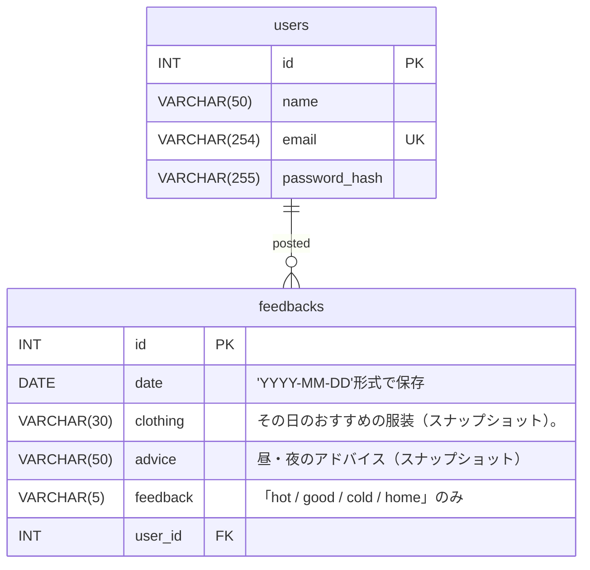

# 設計

<!-- チェックポイント④の合格条件:
     講師（レビュー役）の「なぜ？」に自分の言葉で答えられる /
     技術選定のすべてに、他の候補と選んだ理由が書かれている
     「（自分で書く）」の所は、まだ決めていない、または理由をまだ言葉にしていない所 -->

## テーブル設計

### ER 図

### users（ユーザー情報）

| 列            | 型           | 制約                         | 補足 |
| ------------- | ------------ | ---------------------------- | ---- |
| id            | INT          | NOT NULL, PK, AUTO_INCREMENT |      |
| name          | VARCHAR(50)  | NOT NULL                     |      |
| email         | VARCHAR(254) | NOT NULL, UNIQUE             |      |
| password_hash | VARCHAR(255) | NOT NULL                     |      |

### feedbacks（感想）

| 列       | 型          | 制約                            | 補足                                                                                                |
| -------- | ----------- | ------------------------------- | --------------------------------------------------------------------------------------------------- |
| id       | INT         | NOT NULL, PK, AUTO_INCREMENT    |                                                                                                     |
| date     | DATE        | NOT NULL                        | "YYYY-MM-DD"形式で保存                                                                              |
| clothing | VARCHAR(30) | NOT NULL                        | その日のおすすめの服装（スナップショット）。値は「おすすめのルール」の「服の段階」の表の「DB の値」 |
| advice   | VARCHAR(50) |                                 | 昼・夜のアドバイス（スナップショット）,アドバイスがない日もあるためnull許容                         |
| feedback | VARCHAR(5)  | NOT NULL                        | 「hot / good / cold / home」のみ                                                                    |
| user_id  | INT         | NOT NULL, FK, ON DELETE CASCADE | 　FK→users.id                                                                                       |

- UNIQUE(user_id, date)→インデックスでuser_idを先に索引することで検索範囲が小さくなるため
- 感想を登録していない日は行を作らない。「家を出ていない」は行を作って `home` を入れる（「未登録」と「家を出ていない」を区別するため）

感想のときに出ていたおすすめは、結果（服装とアドバイス）だけをスナップショットとして保存する。材料（体感温度）から表示のたびに計算し直すと、おすすめのルールを変えたときに過去の日の表示も変わってしまうため。感想は1人1日1件なので、保存する量は少ない。

### 全体

- おすすめのルールは DB ではなくコードの関数に置く（単体テストを書ける、変更が git に残る）。傘などの小物は天気だけで出す
- 列名は英語。作成日時などは必要になったら足す

---

## 技術選定（ADR）

### ADR-1：バックエンドに Hono（Node.js）を使う

**決めたこと**
バックエンドは Hono（Node.js v24、TypeScript）。

**選んだ理由**

- 転職先からの指定

### ADR-2：フロントエンドに React + Vite を使う

**決めたこと**
フロントエンドは React + TypeScript + Vite。型は Hono の RPC（`hc`）で back と共有する。

**他の候補**

- Next.js

**選んだ理由**

- 転職先からの指定が React + Viteか、Next.js
- Hono のキャッチアップで、Vite + `hc` の構成が動いていること
- Next.js はサーバーの役割が Hono と重なるので、あとで学ぶ

### ADR-3：ORM に Drizzle を使う

**決めたこと**
DB の操作は Drizzle。

**他の候補**

- Prisma

**選んだ理由**

- SQL に近い書き方で、SQL も一緒に学べる

**あきらめたこと（トレードオフ）**

- SQLの知識が少し必要

### ADR-4：データベース

**決めたこと**

- 開発: Docker で MySQL を使用
- 本番: EC2 の中で MySQL を使用

**他の候補**

- SQLite
- 本番を RDS

**選んだ理由**

- DB サーバーの接続・管理を学べる
- RDS を使うには追加で料金が必要

**あきらめたこと（トレードオフ）**

- 開発中は Docker でサーバーを立ち上げておく必要がある
- RDS と違ってバックアップを自動でしてくれない(代わりに mysqldump を使用)

### ADR-5：天気の API に Open-Meteo を使う

**決めたこと**
天気は Open-Meteo をサーバー（Hono）から呼ぶ。
日付は日本時間で決める。

**他の候補**

- OpenWeatherMap
- WeatherAPI.com

**選んだ理由**

- 取れる情報が多く、1時間ごとの予報に対応している
- API キーは不要だが、タイムアウト・キャッシュ・レスポンスの検証は学べる

**あきらめたこと（トレードオフ）**

- 無料版は非商用のみ

**サービスが終了したり有料になったりしたときにどうするか**

- interface と DI を使用することで、別 API に移行する際に修正する箇所を1つで済むようにする

### ADR-6：インフラ構成

**決めたこと**

- front は S3
- back と MySQL は EC2
- CloudFront を入り口にして、/api/\* は EC2、それ以外は S3 に振り分ける

**他の候補**

- すべてを EC2 に置く

**選んだ理由**

- front はただのファイルなので S3 で十分、料金もEC2に比べて安い
- back はプログラムを動かし続ける必要があるので EC2
- CloudFront を使用しないと、S3 のウェブサイトの URL は HTTP だけで、パスワードが暗号化されずに流れる。
- CloudFront を使用しないと、画面（S3）と API（EC2）のドメインが別なので、ログインの Cookie がよそのサイトの Cookie として扱われ、ブラウザにブロックされる。

**あきらめたこと（トレードオフ）**

- すべてを EC2 に置くより部品の数が多くなってしまう

**EC2 のポート（セキュリティグループ）**

| ポート | 用途                           | 外からの接続                                          |
| ------ | ------------------------------ | ----------------------------------------------------- |
| 22     | SSH                            | 自分の IP アドレスからだけ（SSM を使うなら閉じる）    |
| 80     | HTTP（CloudFront から API へ） | 許す                                                  |
| 4000   | Hono                           | 開けない（80 で受けて、中で 4000 に渡す）             |
| 3306   | MySQL                          | 開けない（Hono は EC2 の中から `localhost` でつなぐ） |

### ADR-7：整形・Lint

**決めたこと**

- 整形は Biome（back / front とも）。Lint は back が Biome、front が ESLint（Vite のテンプレートのまま）
- TypeScript は back / front とも `~6.0.3` にそろえる

**他の候補**

- Prettier + ESLint

**選んだ理由**

- Hono のキャッチアップと同じ設定
- front の typescript-eslint が TypeScript 6.0までしか対応していない（`>=4.8.4 <6.1.0`）。front が back の型（`AppType`）を読むので、バージョンをそろえておく

**あきらめたこと（トレードオフ）**

- TypeScript のバージョンを`>=4.8.4 <6.1.0`にしておく必要がある

---

## おすすめのルール

### 服の段階

| 服装指数 | 主な服装の目安         | DB の値                 | 結びつく気温の目安 |
| -------- | ---------------------- | ----------------------- | ------------------ |
| 10       | 何を着ても寒い         | `freezing`              | 5℃未満             |
| 20       | ダウンジャケット       | `down_jacket`           | 5℃以上10℃未満      |
| 30       | コート必須             | `coat`                  | 10℃以上12℃未満     |
| 40       | 裏地付トレンチコート   | `lined_trench_coat`     | 12℃以上16℃未満     |
| 50       | 薄手ジャケット         | `light_jacket`          | 16℃以上20℃未満     |
| 60       | 長袖シャツ・カットソー | `long_sleeve_shirt`     | 20℃以上23℃未満     |
| 70       | 半袖＋カーディガン     | `short_sleeve_cardigan` | 23℃以上25℃未満     |
| 80       | 半袖Tシャツ            | `t_shirt`               | 25℃以上30℃未満     |
| 90       | ノースリーブ           | `sleeveless`            | 30℃以上35℃未満     |
| 100      | 暑さ対策必須           | `heat_protection`       | 35℃以上            |

### 時間帯

- 朝: 7時
- 昼: 11〜13時の平均
- 夜: 17〜19時の平均

### 感想のずらし方

- 1件につき1℃ずらす（「寒かった」と「暑かった」は打ち消し合う）
- 1件で1℃ずらしてもずれはそこまで大きくないと判断
- 「家を出ていない」は数えない
- 直近1週間の感想を使う
- ずらすのは最大7℃
- 1日すべて（朝・昼・夜）に反映する

### 傘の判定

- 7〜19時の降水確率を見る
- 7〜12時を午前、13〜19時を午後とする
- 40%以上の時間があれば雨と判断する

### 午後に体感温度が変わるときの文

| 朝の段階                                       | 寒くなるとき      |
| ---------------------------------------------- | ----------------- |
| 60以上（長袖シャツなど、上着なし）             | 羽織るものを1枚   |
| 50・40（薄手ジャケット・裏地付トレンチコート） | もう1枚厚い上着を |
| 30以下（コート・ダウンジャケット）             | マフラーや手袋を  |

暑くなるときは「脱ぎやすい服を着てください」で統一する。
